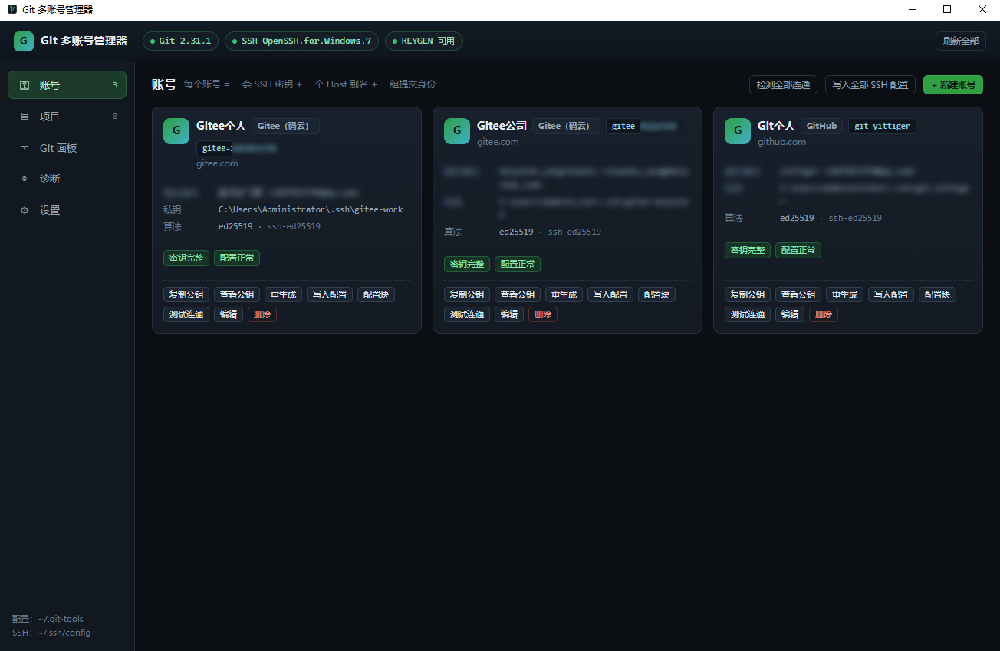
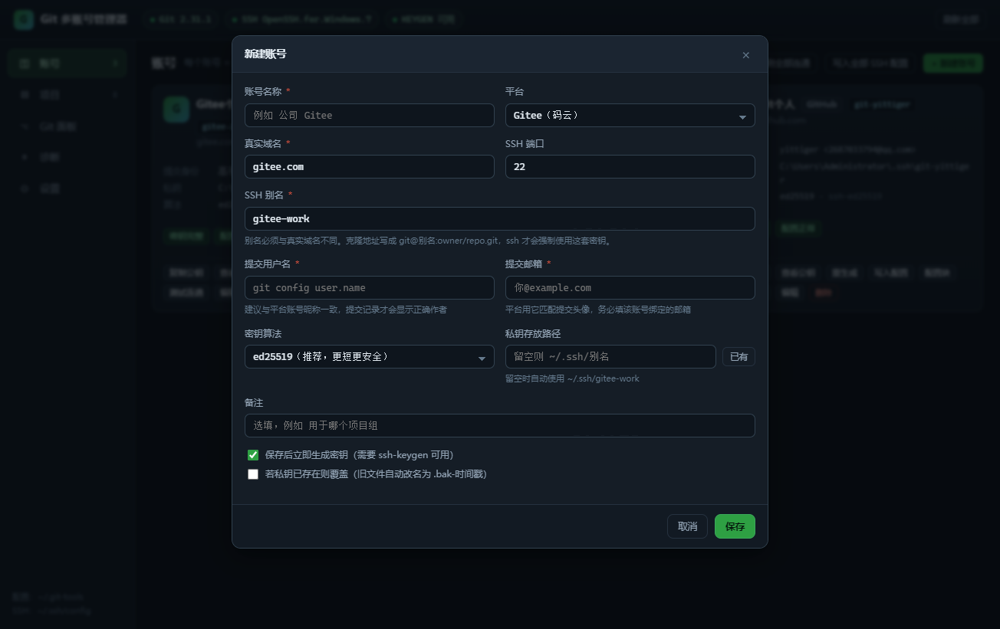
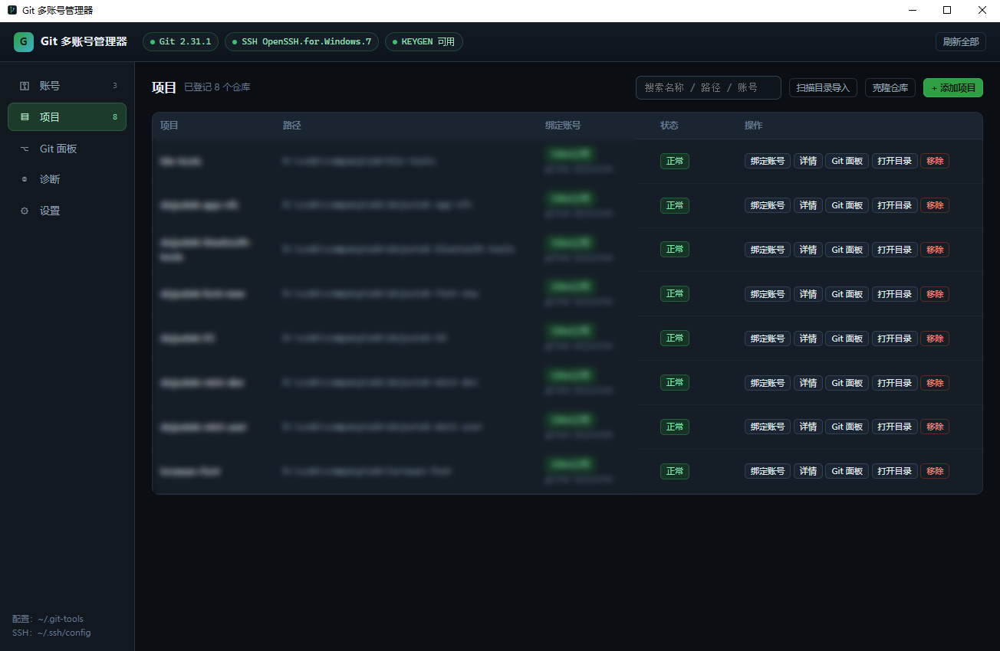
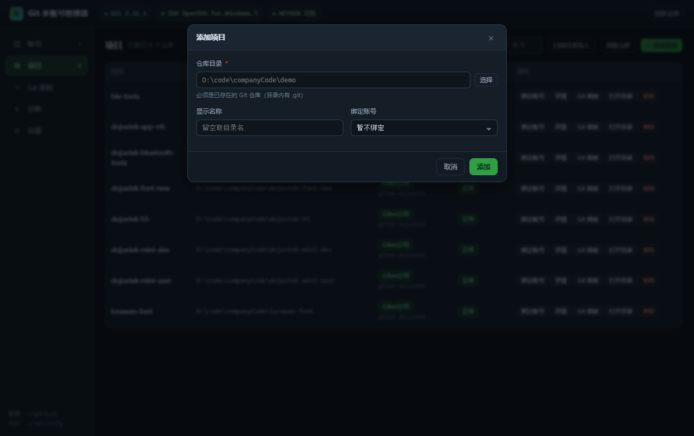
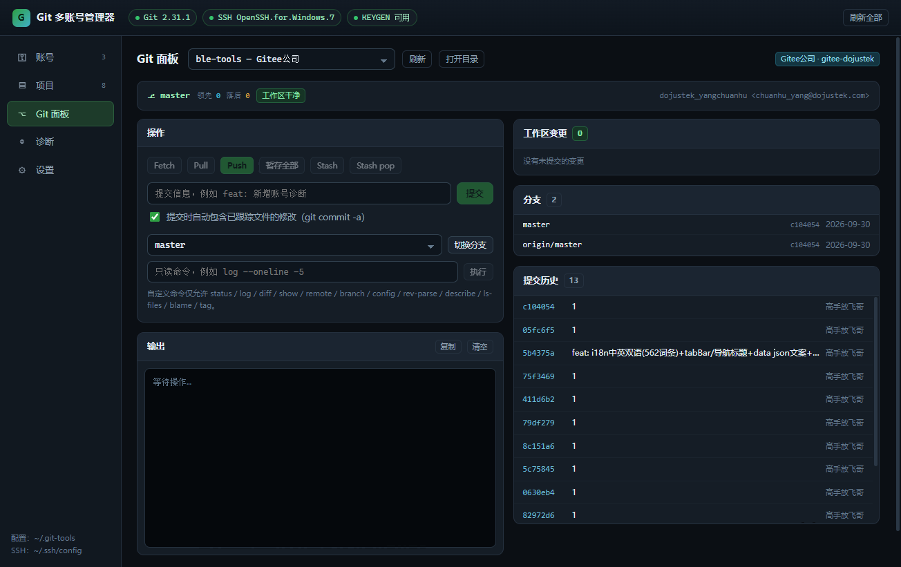
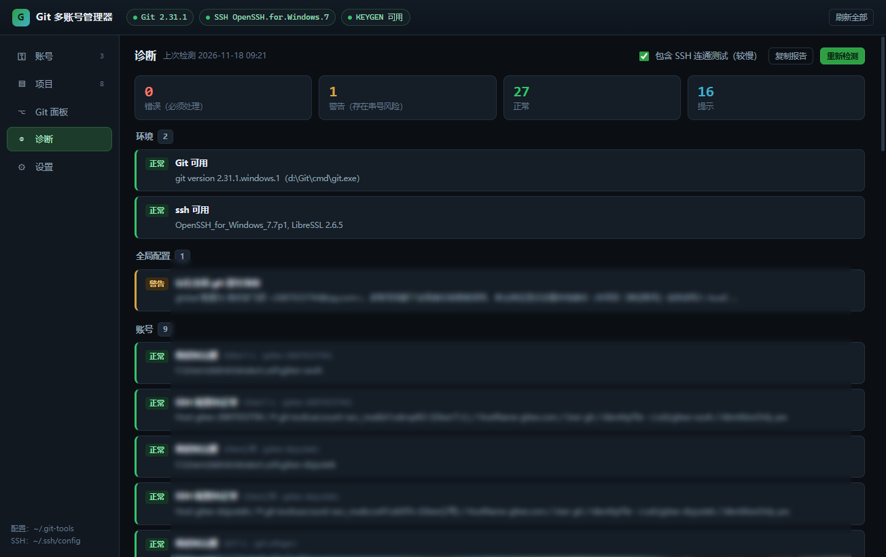
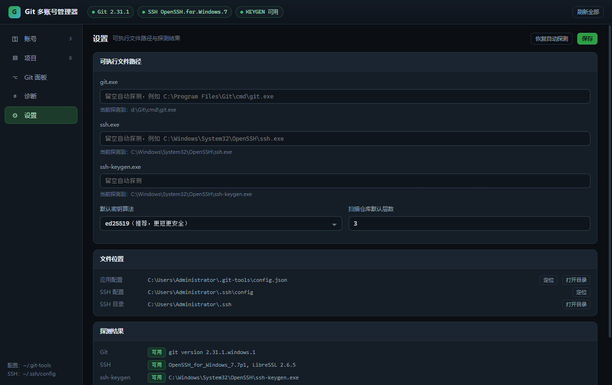

# Git 多账号管理器

一台电脑上管理多个 Git 账号（Gitee / GitHub / GitLab / 自建）的桌面工具。
Electron 33 + Vue 2.7，无需打包工具，`npm start` 直接跑。

解决的问题：同一个域名下有多个账号（公司 Gitee + 个人 Gitee）、
跨平台多个账号混用，导致 **推拉时用错密钥、提交时用错身份、头像邮箱对不上**。

---

## 快速开始

```bash
cd D:\code\companyCode\git-tools
npm install        # 已执行过，node_modules 已就绪
npm start          # 启动应用
npm run dev        # 带开发者工具启动
```

环境要求：

| 组件 | 用途 | 缺失时的影响 |
| --- | --- | --- |
| Git for Windows | 所有仓库读写、克隆、推拉 | 除密钥管理外全部不可用（应用会顶部横幅提示，可在「设置」里手动指定 `git.exe`） |
| OpenSSH 客户端（`ssh` / `ssh-keygen`） | 密钥生成、连通性测试 | 无法生成密钥与测连通（`ssh-keygen` 通常位于 `C:\Windows\System32\OpenSSH`） |

> 本机 Git 已就绪：`D:\Git\cmd\git.exe`（git version 2.31.1），应用启动时自动探测到并在顶部显示版本。
> 换机器或路径不同时无需改代码，可在「设置」里直接指定 `git.exe` 的完整路径。

---

## 界面预览

以下七张截图取自本机实际运行状态，覆盖五个页面与两个关键弹窗。

### 账号页

每个账号渲染成一张卡片：别名、真实域名、私钥路径、算法连同「密钥完整 / 配置正常」标签一并呈现。
卡片底部一排按钮完成日常动作——复制公钥、查看公钥、重生成、写入配置、查看配置块、测试连通。



### 新建账号

一张表单一屏填完。别名下方写明「必须与真实域名不同」的原因；私钥路径留空即按 `~/.ssh/别名` 自动推断；
底部两个复选框控制是否立即生成密钥、是否允许覆盖已有私钥。



### 项目页

已登记仓库以表格列出，右侧状态列直接标出「正常 / 异常」，操作列可绑定账号、查看详情、跳转 Git 面板、打开目录。



### 添加项目

选好仓库目录，填写显示名称，并可在添加时直接绑定账号，省去二次操作。



### Git 面板

顶部一条状态行给出当前分支、领先落后数量与仓库身份；左侧是动作按钮、提交框、分支切换与只读自定义命令，
右侧是未提交变更、分支列表与提交历史，下方为逐行回显的输出区。



### 诊断

顶部四张统计卡给出错误、警告、正常、提示的数量；下方按环境、全局配置、账号三层分组，逐条给出结论与修复入口。



### 设置

可分别指定 `git.exe`、`ssh.exe`、`ssh-keygen.exe` 的路径，并显示当前实际探测到的位置；下方列出应用配置、
SSH 配置与密钥目录的具体文件，便于直接定位。



---

## 打包成 exe

已集成 `electron-builder`，配置在 `electron-builder.yml`。

```bash
npm install              # 首次（会拉 electron-builder）
npm run build            # 一次产出：NSIS 安装包 + 免安装单文件
npm run build:installer  # 只出安装包（nsis）
npm run build:portable   # 只出免安装单文件（portable）
npm run build:dir        # 只解包到 dist/win-unpacked，不出安装包（最快，用于验证）
```

产物都在 `dist/`：

| 文件 | 说明 |
| --- | --- |
| `Git多账号管理器-1.0.0-x64.exe` | NSIS 安装包，可选安装目录、自动建桌面/开始菜单快捷方式，卸载不动 `~/.git-tools` 配置 |
| `Git多账号管理器-1.0.0-portable.exe` | 单文件免安装版，双击即用 |
| `dist/win-unpacked/` | 未压缩的运行目录，调试打包问题时直接跑这里的 exe |

网络慢或拉不到 Electron 二进制时，先设镜像再打包（PowerShell）：

```powershell
$env:ELECTRON_MIRROR="https://npmmirror.com/mirrors/electron/"
$env:ELECTRON_BUILDER_BINARIES_MIRROR="https://npmmirror.com/mirrors/electron-builder-binaries/"
npm run build
```

打包相关说明：

- **没有代码签名**：本地产物未签名，第一次运行 Windows 可能提示「未知发布者」，点「仍要运行」即可；正式分发需购买代码签名证书并在 `win.signtoolOptions` 里配置
- **应用图标**：`build/icon.ico` 已内置（16/24/32/48/64/128/256 七个尺寸内嵌 PNG），打包自动使用；`build/icon.png`（256×256）供非 Windows 平台使用
- **改图标**：换掉 `build/icon-source.png`（建议 1024×1024 以上、带透明通道），再执行 `scripts\make-icon.ps1` 重新生成 ico：
  ```powershell
  .\scripts\make-icon.ps1
  ```
  预览效果看 `build/icon-preview.png`（256/96/48/32/16 五档对照）
- **改版本号**：改 `package.json` 的 `version`，产物文件名随之变化
- `asarUnpack` 里单独放出了 `vue/dist`，确保 `<script>` 能直接从包内加载

---

## 五个页面

### 账号
一个「账号」= 一套 SSH 私钥 + 一个 Host 别名 + 一组提交身份。

- **新建账号**：平台预设自动带出域名；别名默认建议为 `gitee-work` 这类与真域名不同的名字
- **生成密钥**：内置调用 `ssh-keygen`，支持 ed25519 / RSA 4096 / ECDSA 521；已存在则自动备份为 `.bak-时间戳`
- **复制公钥 / 查看公钥**：粘贴到平台的 SSH Keys 页面
- **写入配置**：把该账号的 `Host` 块写进 `~/.ssh/config`（只替换本块，其余内容原样保留，并备份）
- **配置块预览**：写之前先看会写入什么
- **测试连通**：`ssh -T 别名`，并把失败原因翻译成人话（公钥没加到平台 / 别名没解析 / 网络不通）
- **已有密钥导入**：扫描 `~/.ssh` 里现成的密钥对直接登记，不重新生成

### 项目
- **添加项目**：选已有仓库目录（自动校验是否含 `.git`）
- **扫描目录导入**：给一个父目录（如 `D:\code`）和层数，批量找出所有 Git 仓库并逐个指定账号
- **克隆仓库**：粘贴 `git@gitee.com:owner/repo.git`，选账号后自动改写为 `git@别名:owner/repo.git` 再克隆
- **绑定账号**（核心动作，一次做两件事）：
  1. `git remote set-url origin git@<别名>:owner/repo.git`
  2. `git config --local user.name / user.email`（仓库级，不动全局）
- 绑定前展示 diff 预览：远程地址从什么变成什么、提交身份从什么变成什么

### Git 面板
选定项目后可执行：Fetch / Pull / Push / 暂存全部 / 提交 / 切换分支 / 设置上游并推送 / Stash。
- 命令输出**流式**回显在终端区（stderr 标红）
- 侧栏显示分支、领先/落后、变更文件、分支列表、提交历史
- 自定义命令仅允许只读子命令（status / log / diff / show / remote / branch / config / rev-parse / describe / ls-files / blame / tag）

### 诊断
按「环境 → 全局配置 → 账号 → 项目」四层检查，逐条给出可点的修复按钮：

| 检查项 | 说明 |
| --- | --- |
| Git / ssh / ssh-keygen 是否可用 | 缺失直接报错误 |
| 全局 user.name / user.email | 有全局身份时提示串号风险 |
| ssh config 重复 Host | 重复别名只有第一个生效 |
| 私钥 / 公钥缺失 | 一键生成 |
| SSH 配置块缺失或不完整 | 一键按账号重写 |
| 两个账号共用同一私钥 | 平台侧会当成同一个人 |
| 远程地址未使用别名（写在真域名上） | **最容易串号的坑**，一键改写 |
| 远程地址仍是 HTTPS | 建议改用别名 SSH（HTTPS 走系统凭据，多账号易冲突） |
| 仓库未设本地身份 / 身份与账号不一致 | 一键写入 local 身份 |
| 报告 | 可一键复制成纯文本 |

### 设置
手动指定 `git.exe` / `ssh.exe` / `ssh-keygen.exe` 路径、默认密钥算法、扫描层数；
展示配置文件位置与探测结果，可直接在资源管理器定位。

---

## 为什么是「别名 + 仓库级身份」

```
~/.ssh/config
Host gitee.com                 ← 不加别名的地址，ssh 只能盲试默认密钥
  HostName gitee.com
  IdentityFile ~/.ssh/id_rsa

Host gitee-work                ← 公司账号
  # git-tools:account=acc_xxx (公司 Gitee)
  HostName gitee.com
  User git
  IdentityFile ~/.ssh/gitee-work
  IdentitiesOnly yes           ← 强制只用这把钥匙，不试别的

Host gitee-person              ← 个人账号，同域名不同别名
  HostName gitee.com
  User git
  IdentityFile ~/.ssh/gitee-person
  IdentitiesOnly yes
```

- **别名**决定用哪把钥匙：`git@gitee-work:owner/repo.git` 只会用 `gitee-work` 那把
- **仓库级身份**决定提交署名：`git config --local user.name/email` 优先级高于 global，且只影响这一个仓库
- 两者必须同时正确，才既不推错号、也不署名错

`IdentitiesOnly yes` 是关键：没有它，ssh 会先挨个试 `~/.ssh` 下的钥匙，试到能通的那把就用了——正是串号的直接原因。

---

## 裸域名地址（最容易踩的坑）

别名块**只对写了别名的地址生效**。下面这种从平台网页直接复制的地址不会命中任何别名块：

```
git@github.com:owner/repo.git     ← ssh 只试 ~/.ssh/id_rsa
```

此时 ssh 的日志是「Offering public key: .../.ssh/id_rsa」→ `Permission denied (publickey)`，
和你「公钥明明加过了却没生效」的感受完全对上：

- 公钥是加在平台上的，加的是**别名账号**对应的那把私钥；
- 但裸域名这次根本没用到那把私钥，只用了默认的 `id_rsa`；
- 临时救场的办法就是 `ssh-add ~/.ssh/git-yittiger` 把钥匙塞进 ssh-agent，下次重开终端又失效。

三种正规解法（工具里都能一键做到）：

1. **克隆时选账号**：地址会被自动改写成 `git@git-yittiger:owner/repo.git`；未选账号时也会按域名自动匹配唯一账号。
2. **给单账号域名生成「域名兜底映射」**：在账号卡片点「域名兜底」或诊断页修复，写入
   ```
   Host github.com
     # git-tools:domain=acc_xxx (Git个人)
     HostName github.com
     User git
     IdentityFile ~/.ssh/git-yittiger
     IdentitiesOnly yes
   ```
   之后任何地方用 `git@github.com:...` 都会直接用对私钥，不需要 ssh-agent。
3. **改 remote**：已有仓库用「绑定账号」把 remote 改成别名地址。

注意：同一域名下有多个账号时（例如两个 Gitee 号）**不能**生成兜底映射——裸域名无法确定用谁，工具会直接拒绝并提示改用别名。

---

## SSH 客户端实现：OpenSSH 还是 plink

整套别名方案（`Host 别名` / `IdentityFile` / `IdentitiesOnly`）都建立在 **OpenSSH 的 config 语义**上。换成 PuTTY 系客户端，配置就整段失效：

| 客户端 | 报错措辞 | 读 `~/.ssh/config` |
|---|---|---|
| OpenSSH（Windows 自带 / Git 自带） | `Could not resolve hostname` | 读 |
| PuTTY / TortoisePlink | `Unable to open connection: Host does not exist` | **不读** |

plink 只认 PuTTY 自己的 session 列表，于是 `git@gitee-dojustek:owner/repo.git` 会被当成"不存在的 Host"，看起来像密钥没配好，实际是客户端换了实现。

**诊断页会主动检测**这几处来源（优先级与 git 一致）：

```
GIT_SSH_COMMAND > GIT_SSH（含用户级持久变量）> core.sshCommand(global) > PATH ssh
TortoiseGit SSH  ← 只影响 TortoiseGit 自己的 GUI 操作
```

检测到 plink 时给出一条「错误/警告」项，并提供两条路：

**路线 1（推荐，一键）**：切换 TortoiseGit 的 SSH 客户端到 OpenSSH。工具直接改
`HKCU\Software\TortoiseGit\SSH`（用户级，可随时改回），改完 `TortoiseGitProc.exe`
重新操作即生效。切换后不再依赖 Pageant，`ssh-add` 也不需要。

**路线 2（团队强制用 plink / Pageant 时）**：plink 没有 `IdentityFile` 语义，只能显式指定：

```bat
:: 1) 私钥转 PuTTY 格式
puttygen C:/Users/xxx/.ssh/gitee-dojustek -O private -o C:/Users/xxx/.ssh/gitee-dojustek.ppk

:: 2) 仓库级指定 plink + 私钥（不能用别名地址，remote 要写回真实域名）
git config --local core.sshCommand "plink -batch -i C:/Users/xxx/.ssh/gitee-dojustek.ppk"
```

诊断项里会把上面两条命令按你实际的密钥路径填好，直接复制执行即可。

---

## 目录结构

```
git-tools/
├─ package.json          # 依赖：vue 2.7 / electron 33 / electron-builder
├─ .npmrc                # 国内镜像（含 electron 二进制镜像）
├─ electron-builder.yml  # 打包配置（nsis 安装包 + portable 免安装）
├─ build/
│  ├─ icon-source.png    # 图标母版（1024+，透明底）
│  ├─ icon.ico           # 七尺寸 Windows 图标（打包使用）
│  ├─ icon.png           # 256×256（mac/linux 使用）
│  └─ icon-preview.png   # 多尺寸预览图
├─ scripts/
│  └─ make-icon.ps1      # PNG → 多尺寸 ICO 生成脚本
├─ docs/
│  ├─ Git多账号管理器-使用说明书.docx
│  └─ images/            # 说明书与 README 引用的界面截图
├─ main/
│  ├─ index.js           # 主进程入口：窗口、单实例锁、菜单
│  ├─ preload.js         # contextBridge 暴露 gitApi（渲染进程不接触 Node）
│  └─ lib/
│     ├─ ipc.js          # 全部 IPC 通道，统一 {ok, ...} 返回
│     ├─ accounts.js     # 账号 CRUD、密钥生成、连通性测试
│     ├─ projects.js     # 项目 CRUD、URL 解析改写、绑定、克隆、git 动作白名单
│     ├─ diagnose.js     # 四层诊断与修复
│     ├─ sshConfig.js    # ~/.ssh/config 按 Host 块解析 / 增删改
│     ├─ gitRunner.js    # git/ssh/ssh-keygen 定位与执行
│     ├─ proc.js         # 子进程封装（超时、流式输出、错误归一）
│     ├─ store.js        # 原子写入的 JSON 持久化
│     └─ paths.js        # ~/.ssh、~/.git-tools 等路径约定
├─ renderer/
│  ├─ index.html         # 根模板
│  ├─ app.js             # 根实例：环境信息、共享列表、Toast
│  ├─ styles.css         # 深色主题
│  ├─ components/ui.js   # 弹窗 / Toast / 空状态 / 全局辅助
│  └─ pages/             # accounts / projects / git / diagnose / settings
├─ test/
   ├─ lib-test.js        # 核心逻辑测试（沙箱 HOME，不碰真实配置）
   └─ smoke.js           # 离屏加载真实页面，检查 DOM/UI/IPC
```

数据与文件位置：

| 内容 | 位置 |
| --- | --- |
| 应用配置（账号、项目、设置） | `~/.git-tools/config.json`（原子写入，损坏自动备份回退） |
| SSH 密钥 | `~/.ssh/<别名>`，公钥 `<别名>.pub` |
| SSH 配置 | `~/.ssh/config`（改动前备份 `config.git-tools.bak`） |
| 提交身份 | 各仓库自己的 `.git/config`（从不写 global） |

---

## 测试

```bash
# 核心逻辑（30 项断言，全在临时沙箱目录里跑，不会碰你真实的 ~/.ssh）
node test/lib-test.js

# 真实页面冒烟（离屏窗口，检查渲染、弹窗、表格、IPC）
node_modules\.bin\electron test\smoke.js
```

`test/lib-test.js` 覆盖：远程地址三种格式解析、别名地址生成、别名=域名的拒绝、
配置块写入后原有 Host 与注释是否保留、备份内容是否等于原文、写入幂等、
密钥生成、重复别名拒绝、同域名双账号共存、删除只移除自己的块、
配置损坏时回退默认。

---

## 已知限制与注意事项

- **不会自动打包 exe**（按需求只交付可运行源码）。需要时再装 `electron-builder`。
- 页面用了 Vue 运行时模板编译，因此 CSP 里必须允许 `unsafe-eval`。应用只加载本地文件，风险可控；
  若要彻底消除，需改成预编译 render 函数（引入打包工具）。
- `~/.ssh/config` 的改写基于「Host / Match 为块边界」的文本解析，不处理 `Include` 指令指向的外部文件。
  改动前都会备份，可以随时用 `config.git-tools.bak` 回滚。
- 只管理一个远程名（默认 `origin`），多远程（upstream fork 等）场景请到 Git 面板用只读命令查询。
- 提交身份写入仓库后，如果该仓库又手动 `git config --global` 改了全局身份，仓库级仍优先，不会串。
- 删除账号默认**保留密钥文件**，只有手动取消勾选「保留密钥文件」才会删私钥。

---

## 一次典型上手流程

1. 「账号」→ 新建账号（平台选 Gitee，别名 `gitee-work`，填提交邮箱）→ 勾选生成密钥 → 保存
2. 卡片上「复制公钥」→ 打开 gitee.com → 设置 → SSH 公钥 → 粘贴保存
3. 卡片上「测试连通」→ 出现 `Hi xxx! You've successfully authenticated` 即打通
4. 「项目」→ 扫描目录导入 `D:\code` → 给需要的仓库选账号 → 导入（自动完成绑定）
5. 「诊断」→ 重新检测 → 红色项按提示逐个点修复
6. 之后日常在「Git 面板」里 Pull / Commit / Push 即可
